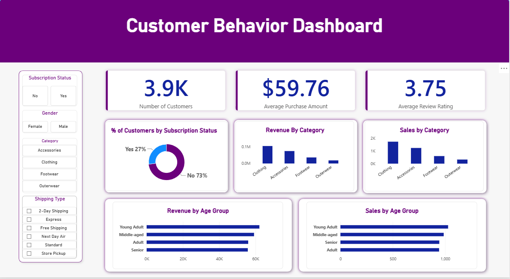

# 📊 Customer Behavior Analysis – Data Analytics Project

## 📌 Overview

This project focuses on analyzing customer behavior and purchasing patterns using Python, MySQL, and Power BI. The objective is to extract meaningful insights from raw data, identify trends, and present findings through interactive visualizations.

The project follows an end-to-end data analytics workflow, starting with data loading and cleaning, followed by Exploratory Data Analysis (EDA), SQL-based analysis, and interactive dashboard development.

## 📁 Dataset

The dataset contains customer-related information, including purchasing behavior, product preferences, and customer demographics.

**Dataset Details:**
- Dataset Name: Customer Behavior Dataset
- Format: CSV
- Data Source: https://github.com/amlanmohanty1/customer-trends-data-analysis-SQL-Python-PowerBI/blob/main/customer_shopping_behavior.csv
- Key Information: Customer details, product categories, purchases, and other relevant attributes.

## 🛠️ Tools & Technologies

| Tool | Purpose |
|---|---|
| Python | Data analysis and preprocessing |
| Pandas | Data manipulation and cleaning |
| NumPy | Numerical operations |
| Matplotlib | Data visualization |
| Seaborn | Statistical data visualization |
| MySQL Server | Database management and SQL analysis |
| MySQL Workbench | SQL queries and database exploration |
| Power BI | Interactive dashboard development |
| Jupyter Notebook | Python development environment |

## 🔄 Project Workflow

### 1. Data Loading
- Imported the dataset into Python using Pandas.
- Examined the dataset structure, dimensions, and data types.

### 2. Exploratory Data Analysis (EDA)
- Analyzed data distributions and patterns.
- Identified trends in customer purchasing behavior.
- Explored relationships between different variables.
- Used visualizations to understand key business patterns.

### 3. Data Cleaning & Preprocessing
- Checked for missing and duplicate values.
- Handled inconsistencies in the dataset.
- Corrected data types where necessary.
- Prepared the dataset for further analysis.

### 4. SQL Analysis – MySQL
- Imported the cleaned dataset into MySQL Server.
- Performed SQL queries to extract meaningful insights.
- Used filtering, aggregation, joins, subqueries, and window functions.
- Identified purchasing trends and product performance.

### 5. Power BI Dashboard
- Connected the analyzed data to Power BI.
- Created interactive visualizations and charts.
- Developed KPIs to highlight important business metrics.
- Designed an interactive dashboard to communicate key findings.

## 📊 Dashboard

The Power BI dashboard provides an interactive overview of customer purchasing behavior and business performance.

**Key Areas Covered:**
- Customer demographics and purchasing patterns.
- Product category performance.
- Popular and frequently purchased products.
- Purchase trends and key business metrics.

**Dashboard Preview:**
dashboard_preview.png


## 📈 Results & Key Insights

The analysis helps identify important patterns in customer purchasing behavior and product preferences.

Key findings include:
- Identification of popular product categories.
- Analysis of customer purchasing patterns.
- Identification of frequently purchased products.
- Insights into customer demographics and spending behavior.
- Data-driven observations to support business decisions.

*Note: Add your actual numerical findings and key insights here.*

## 🚀 How to Run the Project

Follow these steps to explore and reproduce the analysis:

**1. Clone the Repository**

```bash
git clone  https://github.com/om-ghate/customer-behavior-analysis.git  
```

**2. Navigate to the Project Directory**

```bash
cd REPOSITORY
```

**3. Install Required Python Libraries**

```bash
pip install pandas numpy matplotlib seaborn sqlalchemy mysql-connector-python
```

**4. Run the Jupyter Notebook**

Open the `.ipynb` file in VS Code or Jupyter Notebook and execute the cells.

**5. Set Up MySQL**
- Install and configure MySQL Server.
- Open MySQL Workbench.
- Import the cleaned dataset into your database.
- Execute the SQL scripts provided in the repository.

**6. Open the Power BI Dashboard**

Open the `.pbix` file using Power BI Desktop. Update the data source connection if required.

## 📂 Project Structure

```text
Customer-Behavior-Analysis/
│
├── Dataset/
│   └── customer_shopping_behavior.csv
│
├── Python/
│   └── customer_shopping_behavior.ipynb
│
├── SQL/
│   └── customer_shopping_behavior.sql
│
├── PowerBI/
│   └── customer_shopping_behavior.pbix
│
├── Images/
│   └── dashboard_preview.png
│
└── README.md
```

## 👨‍💻 Author

**Om Ghate**

- GitHub: ([https://github.com/om-ghate])
---

⭐ If you find this project useful, feel free to star the repository!
